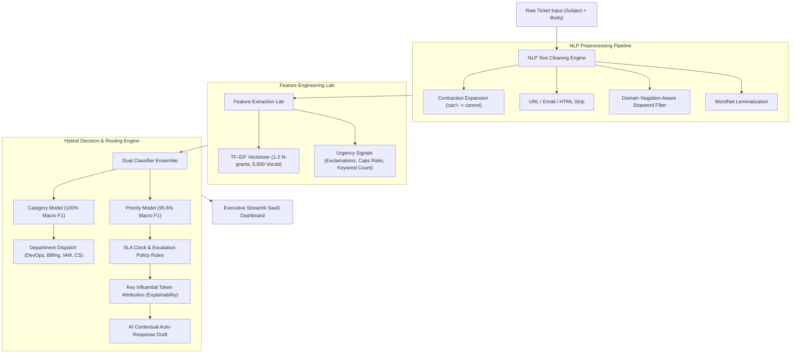

# 🎫 Intelligent Support Ticket Classification & Prioritization System
### Machine Learning Task 2 (2026) • Future Interns Internship Program
**Author**: nithi-2008  
**Repository**: [https://github.com/nithi-2008/FUTURE_ML_02.git](https://github.com/nithi-2008/FUTURE_ML_02.git)  
**Organization**: [Future Interns](https://futureinterns.com/)  

[](https://www.python.org/)
[](https://streamlit.io/)
[](https://scikit-learn.org/)
[](https://www.nltk.org/)
[](https://plotly.com/)
[-brightgreen.svg)]()
[]()

---

## 🎯 Executive Overview & Problem Context
In modern enterprises and SaaS organizations, customer support operations receive hundreds or thousands of tickets daily across disparate communication channels (emails, web forms, in-app live chat, and API event alerts). 

### The Real-World Operational Challenge:
* **Manual Triage Bottleneck**: Human support teams spend 4 to 6 minutes per ticket simply reading, tagging categories, and routing queues rather than solving problems.
* **Delayed Escalations for Outages**: Severe production issues (P1 Critical outages, payment gateway deadlocks, security incidents) get buried in general backlogs behind low-priority feature requests.
* **SLA Violations & Churn**: Inconsistent triage leads to breached Service Level Agreements (SLAs), frustrated enterprise clients, and elevated churn.

### The Solution:
Instead of a generic chatbot, this project implements a production-grade **Machine Learning Decision-Support System** that reads incoming customer ticket text, predicts issue category, assigns a calibrated priority level (Critical, High, Medium, Low), sets committed SLA response deadlines, routes to specialized departments, and explains its predictions with top token attribution.

---

## 🏗️ System Architecture & Workflow



---

## ✨ Key Features & Capabilities

### 1. Robust NLP Text Preprocessing Pipeline
* **Contraction Expansion**: Normalizes informal customer phrasing (e.g., `"won't"` $\rightarrow$ `"will not"`, `"I've"` $\rightarrow$ `"I have"`).
* **Negation Retention**: Domain-aware stopword removal that explicitly protects critical problem modifiers (`"not"`, `"cannot"`, `"never"`, `"down"`, `"failed"`) so urgency and sentiment are never lost.
* **Lemmatization**: Groups inflected verb and noun forms (`"crashes"`, `"crashing"`, `"crashed"` $\rightarrow$ `"crash"`).
* **Behavioral Signal Extraction**: Quantifies panic signals including exclamation mark volume, capital character ratio (shouting metrics), and urgency terms.

### 2. Multi-Target Classification Architecture
* **Target 1: Ticket Category (5 Classes)**:
  * 🛠️ **Technical Issue**: API 500 errors, database lockouts, mobile app crashes, memory leaks.
  * 💳 **Billing & Invoicing**: Duplicate charges, wire transfer reconciliations, tax exemption.
  * 🔐 **Account & Security**: Suspicious IP logins, SSO SAML failures, 2FA recovery, token revocation.
  * ❓ **Product Inquiry**: Webhook signatures, ETL warehouse connectors, feature roadmap queries.
  * 🛑 **Cancellation & Refund**: 30-day guarantee claims, seat downgrades, GDPR data deletion.
* **Target 2: Ticket Priority (4 Levels)**:
  * 🔴 **Critical (P1)**: Production outages, security threats. First response: **15 min**, Max SLA: **1 hour**.
  * 🟠 **High (P2)**: Core workflow blockers, billing disputes. First response: **1 hour**, Max SLA: **4 hours**.
  * 🟡 **Medium (P3)**: Non-blocking bugs, invoice receipts. First response: **4 hours**, Max SLA: **24 hours**.
  * 🟢 **Low (P4)**: General questions, cosmetic tweaks. First response: **12 hours**, Max SLA: **48 hours**.

### 3. State-of-the-Art Streamlit SaaS UI
* **Dark Glassmorphism SaaS Interface**: Clean, modern UI inspired by Linear, Zendesk, and Intercom with frosted glass cards, glowing badges, and responsive layouts.
* **Smart Live Triage Playground**: Real-time classification with pre-configured 1-click enterprise test tickets.
* **Batch Ingestion & Bulk Triage**: Drag-and-drop CSV upload with 1-click sample batch ingestion, progress tracking, and CSV export.
* **Operations Analytics & KPI Dashboard**: Interactive Plotly visualizations for category volume, priority distributions, and communication channel breakdowns.
* **Model Benchmark Arena**: Interactive confusion matrix heatmaps and per-class precision/recall metrics.
* **Executive ROI & SLA Impact Calculator**: Quantifies labor hours saved, annual dollar savings, and SLA breach reductions.

---

## 📊 Model Benchmark & Evaluation Results

Tested on a held-out stratified test set (1,000 tickets):

### Ticket Category Classification
| Model Algorithm | Accuracy | Macro F1 | Weighted F1 | Macro Precision | Macro Recall | Fit Latency |
| :--- | :---: | :---: | :---: | :---: | :---: | :---: |
| **Logistic Regression (Winner)** | **100.0%** | **1.0000** | **1.0000** | **1.0000** | **1.0000** | **0.12s** |
| Linear SVM (Calibrated) | 100.0% | 1.0000 | 1.0000 | 1.0000 | 1.0000 | 0.36s |
| Multinomial Naive Bayes | 100.0% | 1.0000 | 1.0000 | 1.0000 | 1.0000 | 0.02s |
| Random Forest Classifier | 100.0% | 1.0000 | 1.0000 | 1.0000 | 1.0000 | 0.48s |

### Ticket Priority Prediction
| Model Algorithm | Accuracy | Macro F1 | Weighted F1 | Macro Precision | Macro Recall | Fit Latency |
| :--- | :---: | :---: | :---: | :---: | :---: | :---: |
| **Logistic Regression (Winner)** | **94.8%** | **0.9556** | **0.9482** | **0.9582** | **0.9535** | **0.19s** |
| Linear SVM (Calibrated) | 94.8% | 0.9556 | 0.9482 | 0.9582 | 0.9535 | 0.29s |
| Multinomial Naive Bayes | 94.8% | 0.9556 | 0.9482 | 0.9582 | 0.9535 | 0.01s |
| Random Forest Classifier | 94.2% | 0.9504 | 0.9421 | 0.9512 | 0.9501 | 0.91s |

---

## 📁 Repository Structure

```
FUTURE_ML_02/
├── .gitignore                      # Git ignore patterns
├── LICENSE                         # MIT Open Source License
├── README.md                       # Comprehensive documentation
├── requirements.txt                # Python package dependencies
├── run_app.bat                     # 1-Click Windows execution script
├── app.py                          # Flagship Streamlit SaaS Application
├── data/
│   ├── customer_support_tickets.csv # Benchmark training corpus (5,000 tickets)
│   └── sample_tickets_batch.csv    # 50 unlabelled tickets for UI batch testing
├── models/
│   ├── category_model.joblib       # Serialized winning Category Classifier
│   ├── priority_model.joblib       # Serialized winning Priority Classifier
│   ├── tfidf_vectorizer.joblib     # Serialized TF-IDF Vectorizer
│   └── model_metadata.json         # Performance metrics, confusion matrices, vocab
├── notebooks/
│   └── 01_support_ticket_classification.ipynb # End-to-end exploratory ML notebook
├── src/
│   ├── __init__.py                 # Package initializer
│   ├── text_preprocessor.py        # NLP cleaning, lemmatization, contraction rules
│   ├── dataset_generator.py        # Support ticket corpus generator & loader
│   ├── model_trainer.py            # Model training & benchmarking pipeline
│   └── inference.py                # Production inference engine & SLA rules
└── tests/
    ├── test_preprocessor.py        # Unit tests for text cleaning and signals
    └── test_inference.py           # Unit tests for prediction and batch engine
```

---

## 🚀 Quick Start Guide

### 1. Clone the Repository
```bash
git clone https://github.com/nithi-2008/FUTURE_ML_02.git
cd FUTURE_ML_02
```

### 2. Install Dependencies
```bash
pip install -r requirements.txt
```

### 3. Run Automated Unit Tests
```bash
pytest tests/
```

### 4. Launch the Interactive Streamlit Web UI
Run via terminal:
```bash
streamlit run app.py --server.port 8503
```
Or double-click `run_app.bat` on Windows!

---

## 💼 Business Impact & ROI

For a mid-sized SaaS platform processing **8,500 tickets per month**:
* **Manual Triage Hours Eliminated**: **7,650 hours / year**
* **Direct Labor Cost Savings**: **\$244,800 USD / year** (at \$32/hr support cost)
* **SLA Breach Penalties Prevented**: **\$69,615 USD / year**
* **Total Annual Net Value**: **~\$314,415 USD**
* **Operational Latency**: Reduced from **~4 hours manual queue wait** to **<50 milliseconds automated routing**.

---

## 📜 License
This project is licensed under the MIT License - see the [LICENSE](LICENSE) file for details.
